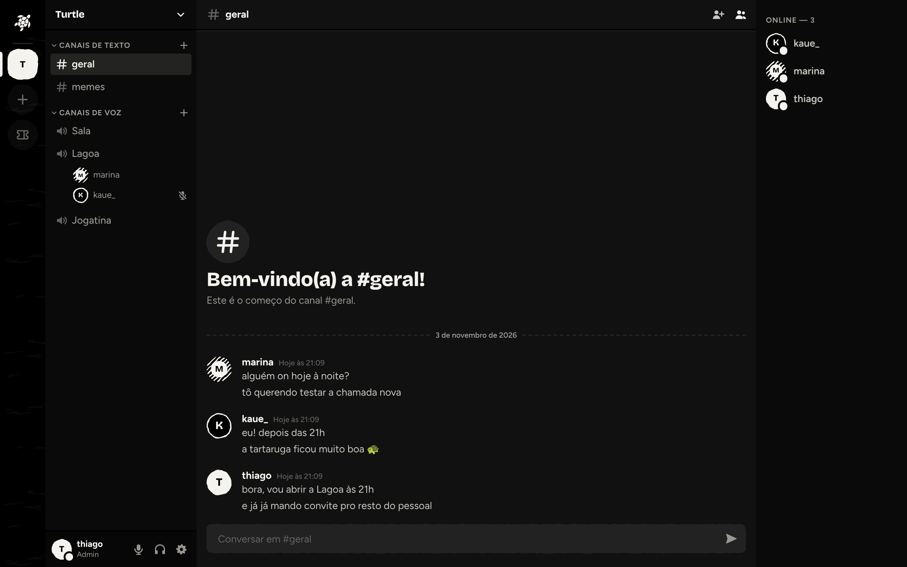
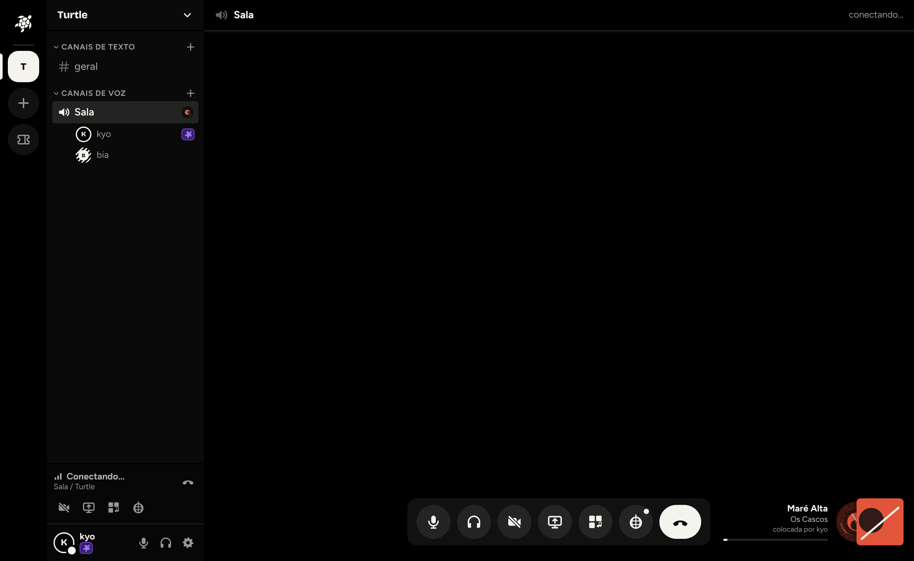
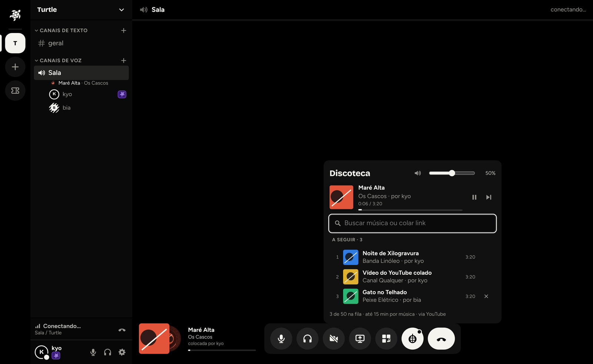
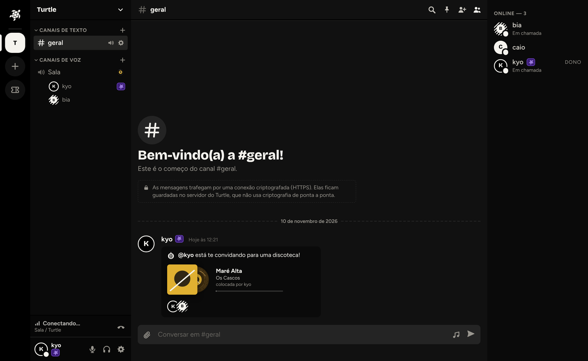
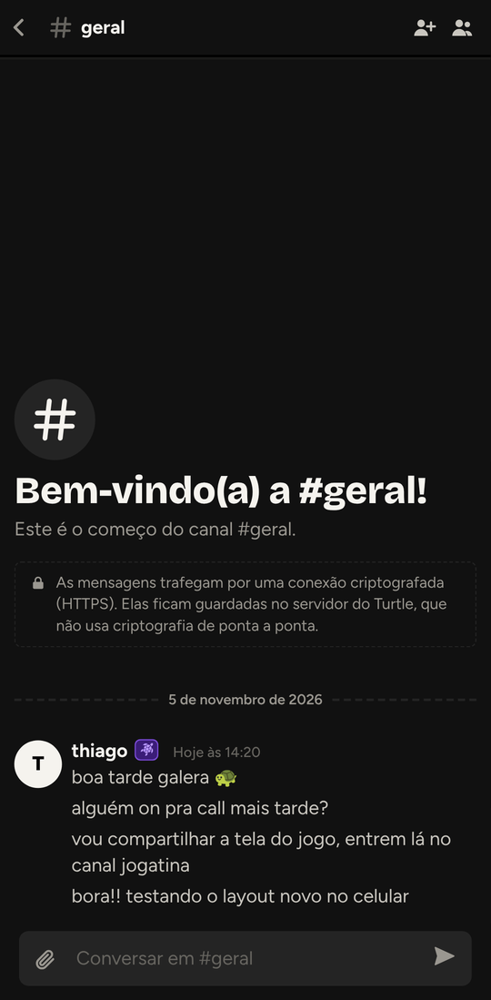
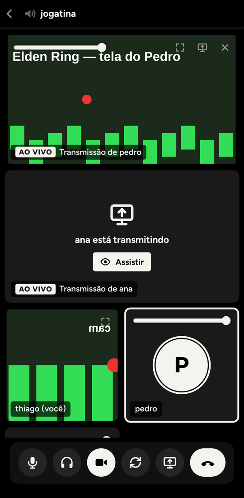

<div align="center">


**Um canto só pra amigos: texto, voz e tela, sem pressa e sem plateia.**

Chat privado no estilo Discord, em preto e branco de xilogravura (linocut), feito para<br>
**chamadas de voz, compartilhamento de tela e câmera**. Open source e hospedado por você.


</div>

---

## · A ideia

Você baixa o Turtle, aluga uma VPS pequena e sobe o seu próprio servidor em uns 15 minutos. Os dados são seus, o domínio é seu, os amigos que entram são os que você convidar. Sem plano, sem anúncio, sem ninguém olhando.

Pensado para grupos pequenos: cerca de **30 contas** e até **6 pessoas por chamada**.

<p align="center">
  <br>
  
</p>

## · Mais capturas

<table>
  <tr>
    <td width="50%"><br><sub><b>Discoteca</b>: bot de música na chamada, com busca e fila.</sub></td>
    <td width="50%"><br><sub><b>Convite pro chat</b>: chame alguém para a discoteca com um cartão de música.</sub></td>
  </tr>
  <tr>
    <td align="center" colspan="2">&nbsp;&nbsp;<br><sub><b>No celular</b>: o mesmo app, responsivo, no navegador ou no app Android.</sub></td>
  </tr>
</table>

## · O que tem

| | |
|---|---|
| **Chat** | Servidores, canais de texto e voz, mensagens diretas, grupos, amigos, fotos e anexos |
| **Voz** | Opus 48 kHz, supressão de ruído (GTCRN, RNNoise, Speex), porta de ruído, volume por pessoa e indicador de quem fala |
| **Tela e câmera** | 1080p30, 720p60 ou 1080p60, com H.264 por hardware (NVENC) e áudio do computador (no Windows, sem capturar o próprio Turtle) |
| **Discoteca** | Bot de música na chamada (YouTube, SoundCloud, Bandcamp), cartões de música no chat e soundboard |
| **Perfil** | Avatar, banner, apelidos e presença (o que você está jogando) |
| **Privado** | Cadastro só por convite do admin, sem listagem pública |
| **Onde roda** | Navegador (também no celular), app desktop para Windows com atualização automática, app Android nativo (Kotlin) e prova inicial para iPhone |

## · Instalar no seu servidor

Você precisa de: uma **VPS** Ubuntu 24.04 (2 vCPU e 4 GB de RAM já servem; Hostinger, Hetzner, DigitalOcean, Oracle…), um **domínio** seu e uns 15 minutos.

### Jeito fácil: peça para uma IA fazer

Abra [docs/instalar-com-ia.md](docs/instalar-com-ia.md), copie o prompt pronto e cole no Claude, ChatGPT ou outro assistente com acesso ao terminal da sua VPS. Ele instala tudo, configura DNS, HTTPS, firewall e backup, e te entrega o link do primeiro convite.

### Jeito manual (resumo)

```bash
# na VPS, com Docker e Compose instalados e dois domínios (app e voz) apontando para o IP dela
git clone https://github.com/sudothi/turtle.git && cd turtle/infra/selfhost
./install.sh app.seudominio.com lk.seudominio.com --up
```

O script gera todas as senhas, cria o `.env` e a configuração do LiveKit e sobe tudo. Depois abra `https://app.seudominio.com/convite/<código que o script mostrou>` para criar a conta admin. Guia completo, com firewall, backup e atualização: [docs/hospedar-em-vps.md](docs/hospedar-em-vps.md).

## · Instalar o app no celular

O site do seu servidor já funciona no navegador do celular. Se quiser o app nativo, ele precisa apontar para o **seu** servidor (`https://app.seudominio.com`); os instaladores prontos do mantenedor apontam para a instância dele.

### Android (nativo, Kotlin)

1. **Baixar o APK pronto para testar:** no GitHub, abra **Actions > Android nativo (APK)**, escolha a execução mais recente e baixe o artefato `turtle-android-nativo` (zip com `turtle-nativo.apk`). No celular, abra o APK e permita a instalação de fontes desconhecidas.
2. **Compilar apontando para o seu servidor** (precisa de JDK 17+ e Android SDK, ou Android Studio):
   ```bash
   cd apps/android
   ./gradlew assembleRelease -PserverUrl=https://app.seudominio.com
   ```
   O APK sai em `app/build/outputs/apk/release/`. Para atualizar um app já instalado, assine sempre com a mesma chave (veja [apps/android/README.md](apps/android/README.md)).

### iPhone (React Native, em evolução)

O app de iPhone é mantido por outra pessoa e ainda está em fase inicial: texto, voz, câmera e recepção de telas funcionam, mas o aceite em aparelho real continua em andamento e não há publicação na App Store. Hoje há dois caminhos, ambos com **conta Apple gratuita** (o app expira em 7 dias e precisa ser renovado):

- **Pelo Xcode** (precisa de Mac com Xcode e CocoaPods, e iPhone com Modo Desenvolvedor): `pnpm install`, `pnpm --filter @turtle/protocol build` e `pnpm ios:device`.
- **Pela AltStore Classic** (instalador `.ipa` sem Xcode no dia a dia): `pnpm ios:ipa` gera o IPA, que você importa pelo AltServer e pela AltStore no iPhone.

Na tela de login, **Configurar servidor** deixa trocar para `https://app.seudominio.com`. Passo a passo completo e limites conhecidos: [apps/ios/README.md](apps/ios/README.md).

## · Rodar para desenvolver

```bash
pnpm install
cp .env.example .env
pnpm infra:up   # Postgres + LiveKit locais (opcional)
pnpm dev        # servidor :3000, site :5173
pnpm desktop    # app Electron, em outro terminal, com o dev rodando
```

Sem `DATABASE_URL` o servidor usa um banco em memória (some ao reiniciar). O primeiro cadastro usa o `BOOTSTRAP_INVITE` do `.env`. Antes de abrir um PR: `pnpm typecheck` e `pnpm test`.

## · Como é feito

TypeScript, pnpm + Turborepo. Servidor em Node/Fastify com WebSocket próprio, PostgreSQL (Drizzle), voz e vídeo pelo [LiveKit](https://livekit.io) (SFU auto-hospedado), Caddy para HTTPS, imagens com sharp.

```
apps/server    API + gateway WebSocket        apps/client    site React
apps/desktop   Electron (Windows)             apps/android   Android nativo (Kotlin/Compose)
apps/ios       prova inicial (React Native)   packages/ui    design system linocut
packages/protocol   tipos compartilhados      packages/db    banco e migrações
infra/         compose, Caddy, LiveKit, backup, deploy      docs/   guias e planos
```

## · Contribuir

Issues e PRs são bem-vindos. Uma branch por mudança (`feat/`, `fix/`, `docs/`…), commits pequenos, `pnpm typecheck` e `pnpm test` passando. O estilo visual é preto e branco, entalhado: leia [packages/ui](packages/ui) antes de mexer na interface. Contexto para agentes de código em [AGENTS.md](AGENTS.md).

## · Licença

[MIT](LICENSE). Faça o que quiser, sem garantias.
