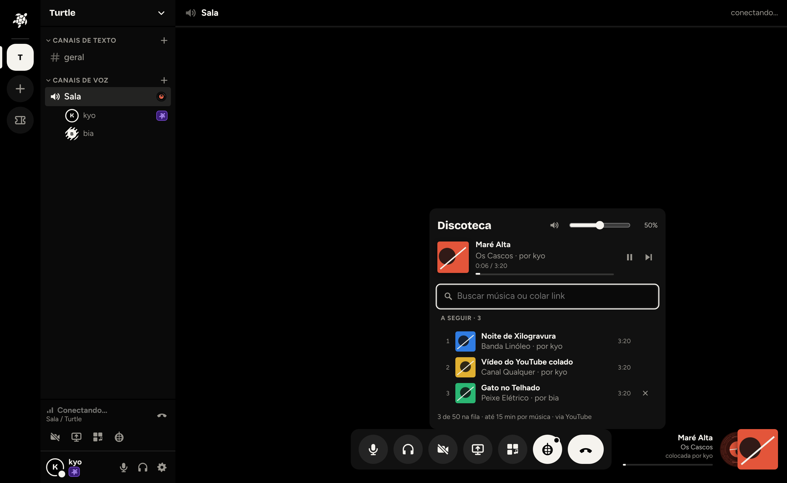
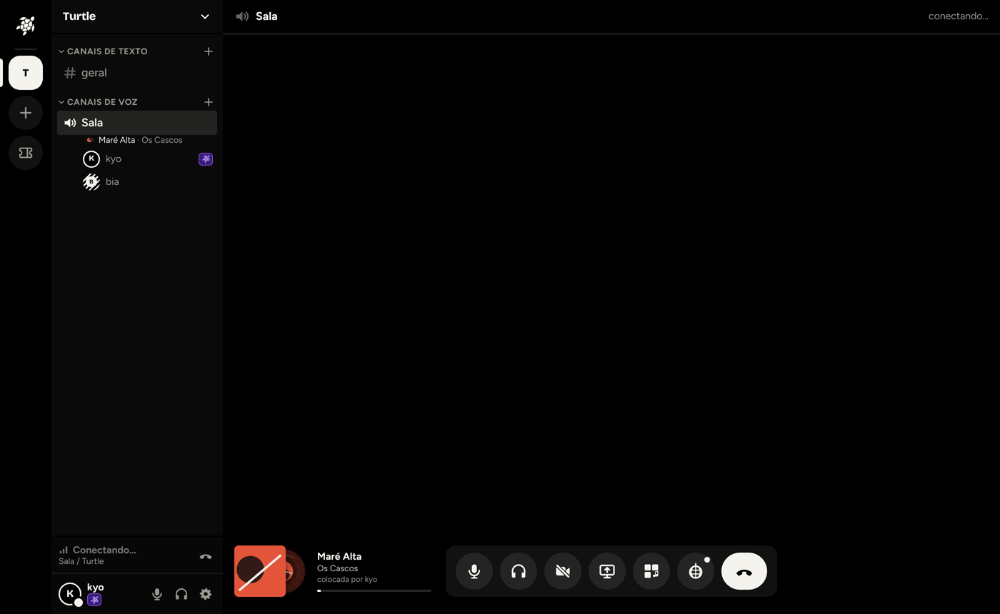
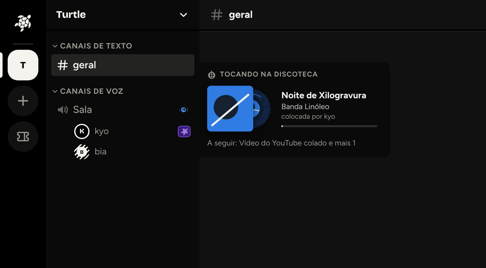
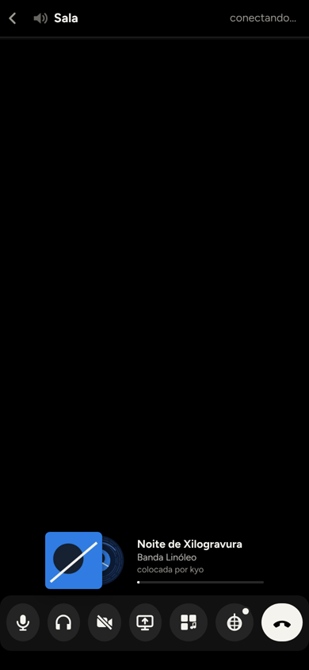
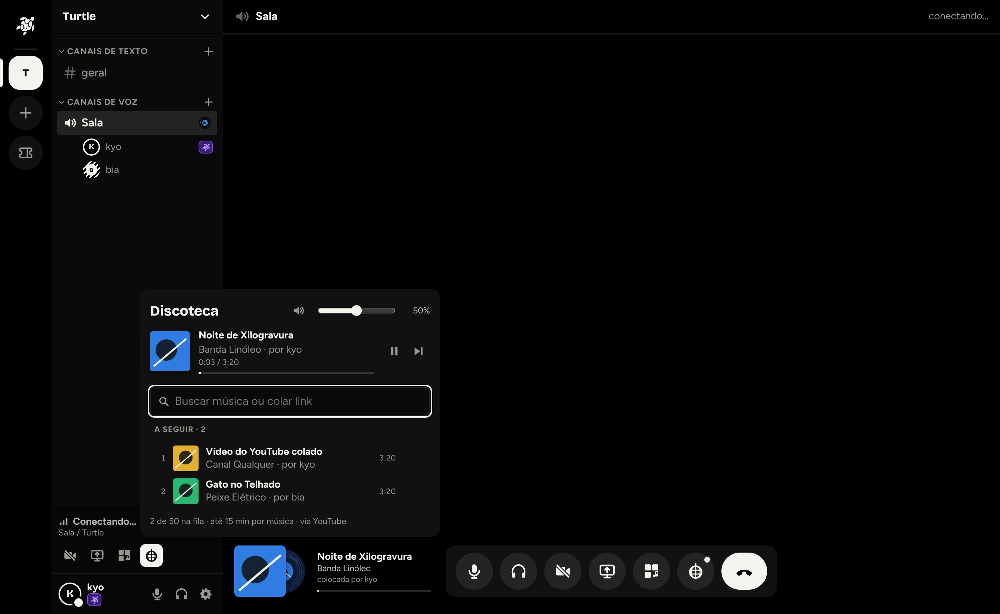

# Discoteca (bot de música da chamada)

Na chamada de um servidor, o botão de discoteca (globo, ao lado do soundboard) abre um painel onde quem está na chamada busca músicas (mesma busca do cartão de música do chat) ou cola links (YouTube, SoundCloud, Bandcamp, Spotify, Deezer) e todo mundo ouve junto: fila, pausar, continuar, pular, tirar da fila e volume de cada pessoa. Quem está na chamada vê no canto inferior direito o cartão com a capa, o vinil girando (tingido com a cor da capa), o nome da música e quem colocou. O botão também fica no painel de voz (embaixo da lista de canais, ao lado de "Compartilhar tela"). Na barra lateral, o canal de voz com música mostra um disquinho girando no canto direito; passando o mouse (ou focando com o teclado) abre um popout com capa, música, quem colocou, progresso e a próxima da fila.

## Decisões

### Sincronia: estado no servidor, cada aparelho toca o próprio áudio (não passa pelo LiveKit)
O servidor guarda, por chamada, a fila e um relógio: `startedAt` (hora do servidor em que a faixa estaria no segundo 0) ou `pausedAt` (posição da pausa). Cada aparelho baixa o arquivo do nosso servidor e toca num `<audio>`, calculando a posição com a diferença entre o relógio dele e o do servidor (vem em cada evento, campo `now`; fica o maior valor visto, porque o atraso da rede só diminui a amostra). Corrige sozinho se escorregar mais de 0,6 s (confere a cada 5 s).

Por que não publicar o áudio no LiveKit como um participante "bot":
- **CPU**: um bot precisaria decodificar e recodificar em Opus no servidor o tempo todo (por chamada). Aqui a VPS só serve um arquivo estático, sem converter nada.
- **Volume por pessoa e ensurdecer**: tocando localmente, cada um escolhe o volume da música separado das vozes (0 a 100%, lembrado no aparelho) e ensurdecer cala a música também. Com o LiveKit seria mais um participante misturado.
- **Qualidade**: o arquivo original (Opus ~130-160 kb/s ou AAC) em vez de Opus de voz recomprimido.
- **Banda**: igual ou menor. São ~4 MB por música por ouvinte, baixados uma vez (com `Range`, pular para o meio não baixa tudo de novo); máx. 6 por chamada ≈ 24 MB por música por chamada, mesmo perfil de 6 ouvintes num SFU.
- Medido no navegador (dois aparelhos na mesma chamada): diferença de posição entre eles abaixo de 30 ms ao tocar, pausar, continuar e pular.

### Áudio de YouTube e outros links: yt-dlp no servidor, com cache em disco
- **Links aceitos**: só faixas de YouTube (`watch`, `youtu.be`, `shorts`, `music.youtube.com`), SoundCloud (`/artista/faixa`) e Bandcamp (`/track/`). O link é normalizado (sai `list=`, rastreio, etc.), e o yt-dlp roda com `--ignore-config --no-playlist --use-extractors youtube,youtube:search,soundcloud,bandcamp` e o link depois de `--`. Nada de site qualquer (o extrator genérico baixaria qualquer URL: risco de SSRF).
- **Busca**: a busca é a do Deezer (igual ao chat). Ao colocar uma música da busca, o servidor procura no YouTube (`ytsearch5:"artista - título"`) e pega o resultado com duração mais próxima (até 20 s de diferença) para não tocar clipe com introdução nem versão ao vivo. Título, artista e capa continuam os do Deezer.
- **Se o YouTube barrar o download** (comum em IP de datacenter, "Sign in to confirm you're not a bot"): a música da busca tenta até 3 vídeos candidatos e, se todos falharem, a faixa é pulada com aviso (sem prévia). Link colado do YouTube que falhar é pulado com aviso.
- **Sem yt-dlp** (ou se a busca no YouTube não achar): toca a prévia de 30 s do Deezer, marcada como "prévia". Links do YouTube/SoundCloud/Bandcamp ficam recusados com aviso.
- **Download**: só o áudio, no formato que vier (`bestaudio`, preferindo Opus ≤170 kb/s ou M4A), sem ffmpeg e sem converter: quase nenhuma CPU. Processo com prioridade baixa (nice 15), no máximo 2 ao mesmo tempo no servidor todo, 3 min de limite e 40 MB por arquivo. O mesmo arquivo pedido por duas chamadas juntas baixa uma vez só.
- **Quando baixa**: a faixa atual e a próxima da fila (a troca de música não espera). As outras só quando chegar a vez.
- **Cache**: `MUSIC_CACHE_DIR` (na imagem Docker, `/data/music-cache`, fora do volume de uploads: não entra no backup e some no deploy, o que não faz falta), até `MUSIC_CACHE_MB` (padrão 1024). Passou do limite, apaga o arquivo ouvido há mais tempo, nunca um que está na fila. Metadados de link resolvidos ficam 6 h em memória (colar o mesmo link de novo não roda o yt-dlp).
- **Capa**: miniatura do link (só hosts `ytimg.com`, `sndcdn.com`, `bcbits.com`) ou capa do Deezer, recortada em WebP 320x320 e guardada no cache.
- **Arquivos sem login**: o `<audio>` não manda o token, então as URLs de áudio e capa levam uma assinatura HMAC (segredo gerado a cada início do servidor). Só quem recebe o estado (membros do servidor) tem a URL.
- **Imagem Docker**: baixa o `yt-dlp_linux` (binário único, sem Python) com versão e SHA-256 fixos no `Dockerfile`, e usa o Node do próprio servidor para os desafios de JavaScript do YouTube (`--js-runtimes node`). `YTDLP_ARGS` permite trocar os argumentos (por exemplo, `--cookies` se o YouTube pedir login).

### Riscos e mitigação
- **Termos de uso**: baixar áudio do YouTube vai contra os termos do YouTube (o SoundCloud e o Bandcamp também não autorizam). O Turtle é privado (~30 contas, sem fins comerciais, nada é redistribuído fora da chamada), mas o risco existe. Mitigações: só quem está na chamada pode colocar música; uma música por vez por chamada; limite de 15 min por faixa (sem lives, sem playlists); cache curto e apagado no deploy; o painel mostra a fonte ("via YouTube"); e dá para desligar tudo tirando `YTDLP_PATH` (fica só a prévia de 30 s do Deezer).
- **Bloqueio do YouTube**: IPs de datacenter às vezes recebem "Sign in to confirm you're not a bot". Quando isso acontecer, a faixa é pulada com aviso ("Não deu para tocar…") e o erro vai para o log. Saídas: atualizar o yt-dlp (trocar versão e hash no `Dockerfile`) ou passar cookies em `YTDLP_ARGS`. Não deu para testar contra o YouTube de verdade no container da nuvem (a rede bloqueia); os testes usam um yt-dlp de mentira e o binário real foi conferido só quanto aos argumentos.

### Permissões e limites
- Só quem está **na chamada** coloca, pausa, continua, pula e tira músicas (são poucos amigos; não há papel de DJ). Quem está fora vê, mas não mexe (403). Quem não é do servidor nem vê (404).
- Fila de até 50 músicas; até 10 por pessoa; 8 adições por minuto por pessoa; 40 ações (pausar/pular) por minuto.
- "Pular" leva o id da faixa: dois cliques ao mesmo tempo não pulam duas.
- Chamada vazia: a música pausa e volta sozinha quando alguém entra; vazia por 2 min, a fila acaba. Apagar o canal ou o servidor acaba com a fila.
- Só chamadas de servidor (DMs e grupos ficam para depois).

## API
- `GET /jukebox/:canal` → `{ state }` (membros do servidor).
- `POST /jukebox/:canal/queue` `{ url }` ou `{ trackId: "dz123" }` → item (só quem está na chamada).
- `POST /jukebox/:canal/pause|resume|skip` (`skip` aceita `{ itemId }`), `DELETE /jukebox/:canal/queue/:item`.
- `GET /jukebox/audio/:assinatura/:arquivo` e `GET /jukebox/cover/:assinatura/:arquivo` (sem login, com `Range`).
- WebSocket: evento `jukebox` `{ channelId, state | null }` para todos do servidor a cada mudança, e o estado de todas as filas logo ao conectar.

## Código
- Servidor: `apps/server/src/jukebox.ts` (fila, relógio, cache), `apps/server/src/ytdlp.ts` (links aceitos e yt-dlp), rotas em `app.ts`, testes em `jukebox.test.ts`.
- Cliente: `apps/client/src/jukebox.ts` (estado e player sincronizado) e `components/Jukebox.tsx` (botão, painel, cartão, disco da barra lateral e popout). O cartão reaproveita o vinil do cartão de música do chat (`Vinyl` em `MusicCard.tsx`).
- Protocolo: `JukeboxState`, `JukeboxItem`, limites `JUKEBOX_*` em `packages/protocol`.

## Capturas (servidor de teste com músicas e capas de mentira)
| Chamada | Fora da chamada | Celular |
|---|---|---|
|  |  |  |

Botão no painel de voz: 
