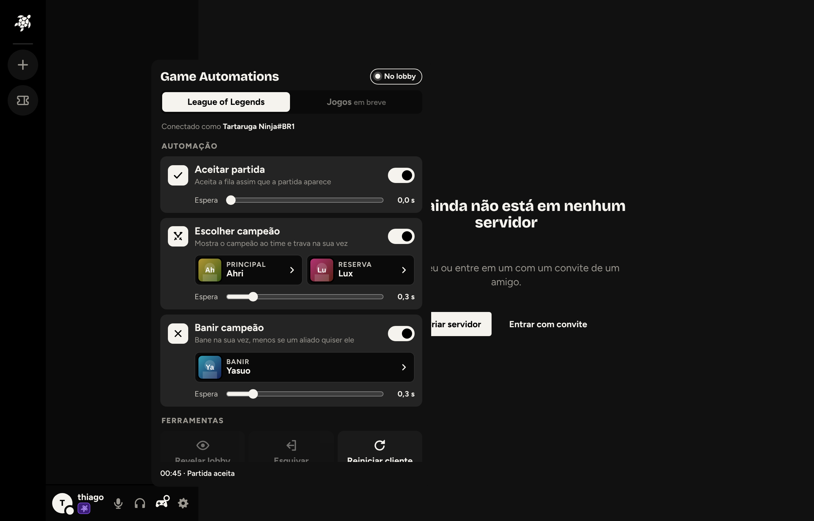
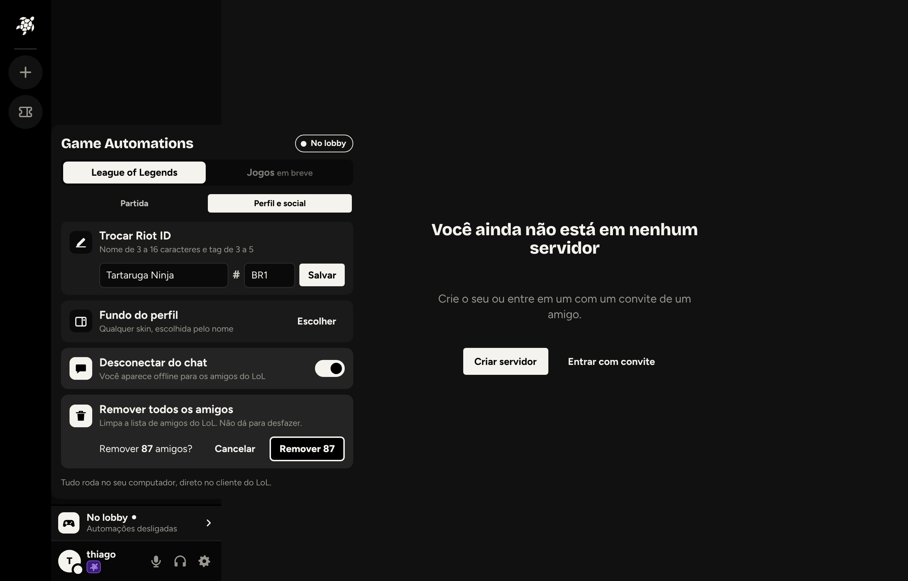
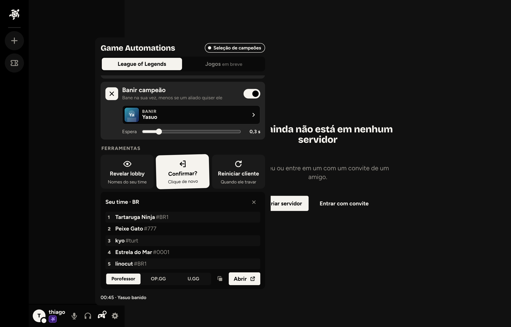
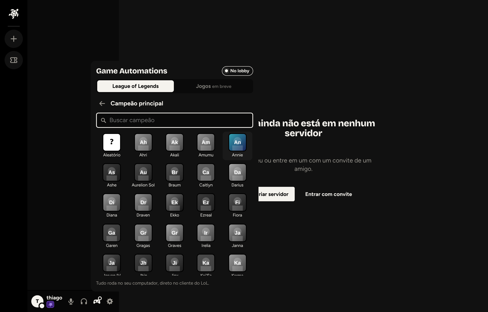
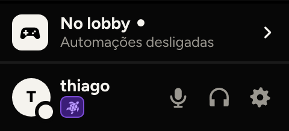

# Game Automations (desktop)

Painel do app desktop, ao lado da Discoteca, que traz para dentro do Turtle as funções de automação do cliente do League of Legends que existiam em ferramentas soltas: o [Tiamat](https://github.com/369gabriel/tiamat) e o Quacky. A aba "Jogos" fica reservada para depois.

## O que entrou (decisão do thiago em 2026-11-11)

| Função | Como funciona |
|---|---|
| Aceitar partida | Na fase `ReadyCheck`, aceita (`POST /lol-matchmaking/v1/ready-check/accept`) depois da espera escolhida (0 a 2 s). Uma vez por partida encontrada. |
| Escolher campeão | Principal (ou **Aleatório**) e reserva. Antes da sua vez só mostra a intenção ao time (hover); na vez, trava. Pula banidos, travados, o que um aliado já quer jogar e o que você não tem; sem nenhum disponível, avisa para escolher na mão. |
| Banir campeão | Bane na sua vez. Se um aliado estiver com aquele campeão na intenção, não bane e avisa. |
| Revelar lobby | Nomes do seu time na seleção (na ranqueada, vindos do chat do Riot Client, como no Tiamat), com links para Porofessor, OP.GG ou U.GG e botão de copiar. |
| Dodge | Sai da seleção sem fechar o cliente (mesmo pedido `quitV2` do Tiamat). Pede confirmação com um segundo clique. A penalidade de esquiva da Riot continua valendo. |
| Reiniciar cliente | `POST /riotclient/kill-and-restart-ux`, para quando o cliente trava. |

**Perfil e social** (pedido do thiago em 2026-11-12, segunda seção do painel):

| Função | Como funciona |
|---|---|
| Trocar Riot ID | `POST /lol-summoner/v1/save-alias`; o cliente responde 200 mesmo quando a Riot recusa, então o erro (`isSuccess: false`) vira mensagem e o nome novo é conferido. |
| Fundo do perfil | Lista de skins **só com o nome** (sem imagem), vinda do próprio cliente (`/lol-game-data/assets/v1/skins.json`), com busca por skin ou campeão. |
| Desconectar do chat | `POST /chat/v1/suspend` e `/chat/v1/resume` no Riot Client: você aparece offline para os amigos do LoL. |
| Remover todos os amigos | Mostra quantos são e pede confirmação com a quantidade; o desktop só remove se a lista ainda tiver aquele tamanho. |

Ficaram de fora: ícone, emblemas, status, fila automática.

## Onde fica a tela
- **Desligado por padrão.** Cada pessoa ativa em Configurações > Game Automations (seção que só existe no app desktop) (guardado no aparelho). Desativar também desliga as automações que estavam rodando.
- **Na chamada:** ícone de controle (`gamepad`) ao lado do botão da Discoteca, no painel "Voz conectada" e nos controles grandes da chamada.
- **Fora da chamada** (decisão do thiago): uma faixa no mesmo lugar do bloco "Voz conectada", acima da barra do usuário, **só com o cliente do LoL aberto ou alguma automação ligada** (o desktop confere o cliente a cada 15 s enquanto a faixa está ativa), com a fase do LoL ("Na fila", "Seleção de campeões"…) e o que está ligado. Clicar abre o painel.
- Um pontinho no ícone avisa que alguma automação está ligada.
- O painel segue o padrão da Discoteca: abas, cartões com interruptor, espera em segundos, seletor de campeão com busca e ícones, e a última ação no rodapé.
- No navegador e no Android nada aparece (`window.turtleDesktop.automations` não existe).

## Arquitetura
- `apps/desktop/src/lcu/client.ts`: acha o cliente pela linha de comando do `LeagueClientUx.exe` (`--app-port`, `--remoting-auth-token` e as do Riot Client), com `tasklist` antes para só chamar o PowerShell se o processo existir; reserva pelo `lockfile`. HTTPS só para `127.0.0.1`. A rich presence (`games.ts`) passou a usar o mesmo cliente.
- `apps/desktop/src/lcu/logic.ts`: regras puras (minha ação da vez, campeões indisponíveis, escolha de pick/ban, links do revelar lobby). Testadas em `logic.test.ts`.
- `apps/desktop/src/lcu/automations.ts`: ciclo que só roda com alguma automação ligada ou o painel aberto (1,5 s normalmente, 0,4 s na fila encontrada e na seleção, 5 s com o cliente fechado). Configurações em `game-automations.json` na pasta de dados do app; lista e ícones dos campeões guardados ali também, para o seletor funcionar com o cliente fechado. Testado com um cliente LoL falso em `automations.test.ts`.
- IPC fechado (`auto:get`, `auto:set`, `auto:watch`, `auto:champions`, `auto:icon`, `auto:tool`, `auto:open`, evento `auto:status`), todos conferindo que veio da janela do app. O site nunca recebe porta nem senha do cliente; `auto:open` só abre os três sites do revelar lobby. Nada passa pelo servidor do Turtle.

## Entrega
Código do processo principal só chega com instalador novo: a versão do desktop subiu para **0.4.0** (e **0.4.1** com Perfil e social). Publicar o instalador precisa de ok escrito do thiago. O painel vai junto com o deploy normal do site e fica escondido em desktops antigos.

## Riscos
O LCU não é API oficial: a Riot pode mudar um endpoint e a função quebra (isolada, sem derrubar o resto). Revelar lobby e esquiva usam caminhos que a Riot não documenta; o thiago decidiu seguir porque as ferramentas já existem. Teste com o LoL de verdade só no Windows do thiago (o container da nuvem não tem o cliente).
